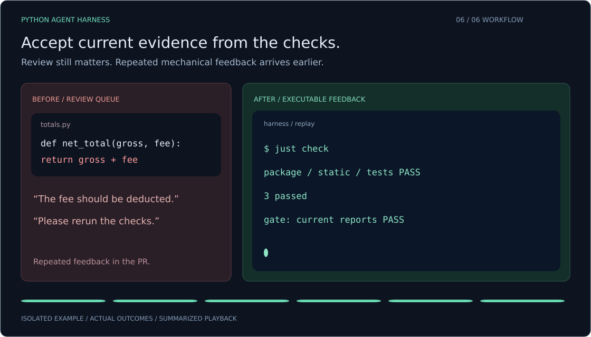

<p align="center">
  
</p>

<h1 align="center">Python Agent Harness</h1>

<p align="center">
  <strong>Give your Python coding agent a quality bar.</strong><br>
  Turn your project's architecture, conventions and invariants into checks you can run locally and enforce in CI.
</p>

<p align="center">
  Python 3.13+ &nbsp;·&nbsp; Zero runtime dependencies &nbsp;·&nbsp; GitHub + GitLab &nbsp;·&nbsp; Early preview
</p>

<p align="center">
  <a href="#quick-start">Quick start</a> &nbsp;·&nbsp;
  <a href="#what-you-get">What you get</a> &nbsp;·&nbsp;
  <a href="#use-your-existing-agent">Agent skills</a> &nbsp;·&nbsp;
  <a href="CONTRIBUTING.md">Contribute</a>
</p>

---

Your agent can write the next feature. Your team still needs a shared definition of
acceptable code: which imports are allowed, what tests must demonstrate, which
checks block a merge, and when a result is too old to trust.

**Python Agent Harness makes those decisions executable.** Agree the requirements
with your agent, record them in one specification, and generate a workflow that
checks the resulting code. Use it for a library, service, CLI or research project.

- **Build around your project.** Capture its architecture and invariants. Adoption
  keeps existing tools such as Poetry, Black and mypy.
- **Give feedback early.** Run formatting, types, custom rules and tests through
  the same configured checks locally and in CI.
- **Keep evidence current.** Bind reports to the source, tests, policy and declared
  inputs. Missing, failed, skipped or stale required evidence blocks the gate.
- **Make deeper testing deliberate.** Add property tests, API contracts and mutation
  testing with an explicit scope and execution budget.

The runtime uses the Python standard library. Bring your existing coding agent;
there is no additional LLM API key or hosted harness service to configure.

## Quick start

You need **Python 3.13+, uv and just**, on Linux or macOS. The runner uses POSIX
process groups; Windows execution is currently unsupported.

From a local checkout, create a project in an empty destination:

```sh
uv sync --locked
uv run --locked harness --root ../my-project init \
  --name my-project --package my_project --kind library \
  --provider github --scaffold
```

Open `../my-project/.harness/project.toml`. Agree the purpose, source and test
roots, architecture boundaries and acceptance criteria with your agent. Then
validate the specification and review the generated changes:

```sh
uv run --locked harness --root ../my-project validate
uv run --locked harness --root ../my-project render
uv run --locked harness --root ../my-project render --apply
```

Run the generated workflow:

```sh
cd ../my-project
git init -b feat/bootstrap
just setup
just check
```

Commit the generated `uv.lock` in your feature branch. CI uses that lock.
The initial version test checks packaging; add behavior tests for your features.

Choose `--kind service`, `cli` or `research` for other project types. Use
`--provider gitlab`, or specify both providers, to generate the corresponding CI.
Each project carries its own `.harness/runner.pyz`, so its checks can run without
an installed copy of this constructor.

**Already have a project?** Start with `inspect`, then `init` **without
`--scaffold`**. Agree the real commands before generating the workflow. Existing
source, tools and unrelated CI jobs are preserved; edited managed files surface
as conflicts. Follow the [adoption guide](docs/usage.md#adopt-an-existing-project).

## What you get

New projects start with a practical toolchain. Existing projects keep their agreed
tools and thresholds.

| Concern | Tool or mechanism | Included in new projects |
| --- | --- | --- |
| Formatting and common defects | Ruff | Required static checks |
| Type correctness | ty | Required static check |
| Unused code | Vulture | Source and tests scanned together |
| Code complexity | Ruff C901 + Complexipy | Cyclomatic and cognitive limits |
| Project-specific syntax rules | ast-grep | Real rule fixtures, snapshots and source scans |
| Behavior and coverage | pytest + coverage.py | Complete source inventory, line and branch gates |
| Generated test cases | Hypothesis | Shared, bounded development and CI profiles |
| Import boundaries | Built-in graph checker | Enforces the boundaries you declare, including transitive imports |
| Distributions | Build and wheel import checks | Required for libraries |
| API contracts | Schemathesis | Optional profile for an agreed schema and isolated service |
| Assertion sensitivity | mutmut + strict acceptance adapter | Optional profile with one worker and explicit budgets |

The scaffold proposes **97% line coverage, 100% branch coverage, cyclomatic
complexity ≤10 and cognitive complexity ≤15**. These are visible configuration,
reviewed with your project's requirements. Coverage measures execution; independent
oracles and meaningful assertions still need tests and review.

`just check` runs the required groups and aggregate gate. Pre-commit runs the
static group. `just deep` explicitly runs configured API, mutation or benchmark
checks. Commands run sequentially with time and output limits; pytest temporary
files stay in the project.

See the [tool workflow guide](skills/build-python-harness/references/tool-workflows.md)
for how each tool connects to a requirement, command and acceptance condition.

## Use your existing agent

Five self-contained skills help your agent build the harness and work within it.
Copy the selected folders, including their references and license notices, into
your agent's skill directory. See [installation details](docs/usage.md#install-the-skills).

| Skill | Ask your agent to… |
| --- | --- |
| [build-python-harness](skills/build-python-harness/SKILL.md) | Create, adopt, audit or update a project-specific harness |
| [spec-to-code-compliance](skills/spec-to-code-compliance/SKILL.md) | Trace requirements to real implementation paths and test evidence |
| [semgrep-rule-creator](skills/semgrep-rule-creator/SKILL.md) | Build and test custom rules with the chosen engine, including ast-grep |
| [property-based-testing](skills/property-based-testing/SKILL.md) | Design useful generators, properties and independent test oracles |
| [mutation-testing](skills/mutation-testing/SKILL.md) | Run a bounded mutmut campaign and distinguish gaps, equivalence and inconclusive results |

For example, once the first skill is installed:

> Use build-python-harness from `/path/to/python-agent-harness` to adopt this
> service. Keep Poetry, Black and mypy. Check our domain-to-adapter import
> boundary, agree the test invariants with me, and preview changes before applying.

Skills guide the agent's decisions. The runtime executes the checks. Requirements
that need human judgment remain explicitly marked for review.

## Make it yours

The specification is a small TOML file in your project. Add checks as argv arrays,
declare architecture boundaries, and map requirements to checks, tests or review.
Include rule configuration, snapshots and non-Python fixtures in `inputs` so
changing them invalidates old reports.

Rendering previews changes before applying them and preserves content outside
managed blocks in `AGENTS.md` and `CLAUDE.md`. You can inspect the generated code,
CI and policy alongside the application in the same pull request.

- [Specification reference](docs/specification.md) — schema, checks and evidence.
- [Usage guide](docs/usage.md) — setup, adoption, optional profiles and operating limits.
- [Protection guide](skills/build-python-harness/references/protection.md) — connect the gate to actual hosting settings.
- [Skill evaluation](docs/skill-evaluation.md) — observed results and what remains unverified.

Generated CI provides the gate; configure branch protection on your hosting
platform to require it. `doctor` reads actual GitHub/GitLab settings and reports
unavailable evidence. A generated workflow alone does not establish server protection.

## Help shape the project

The most useful contributions start with a concrete Python workflow:

- **Bring an adoption case.** Try a flat layout, namespace package or an existing
  toolchain; share the smallest reproduction of any integration problem.
- **Teach it a useful rule.** Include code that should match and code that should
  pass, and run both through the actual engine.
- **Improve a skill.** Show a realistic request, the observed decision and how to
  verify a better outcome.
- **Strengthen the runtime.** Help with provider adapters, report validation,
  packaging or bounded execution, backed by independent regressions.

Start with [CONTRIBUTING.md](CONTRIBUTING.md) for the repository map, local checks
and pull-request expectations. Small, reproducible improvements are welcome.

## Status and license

**Early preview.** The repository includes executable unit/integration checks and
scoped skill evaluations. Automatic host discovery, every agent host and live
provider protection have not all been verified. Runtime checks cannot establish
every business invariant or sandbox arbitrary project code.

The **license for the original project code is still pending**. Public release
and contribution licensing remain unfinished. The four Trail of Bits skill
adaptations carry their own **CC BY-SA 4.0** licenses and attribution notices;
those terms apply to those directories. See the included notices when copying them.
