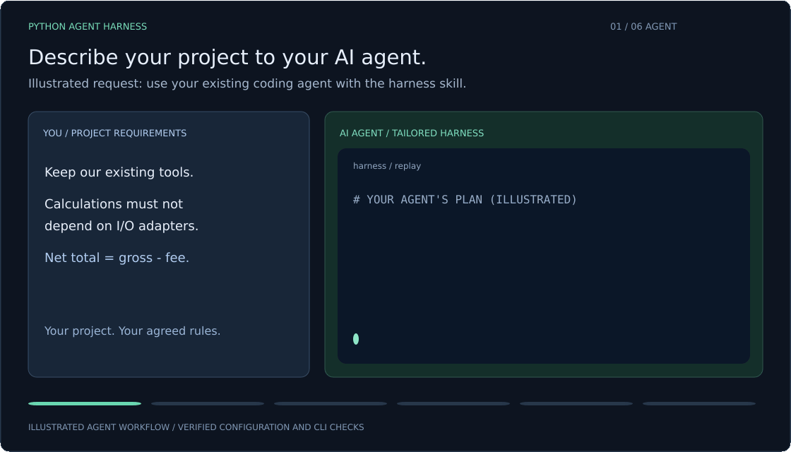
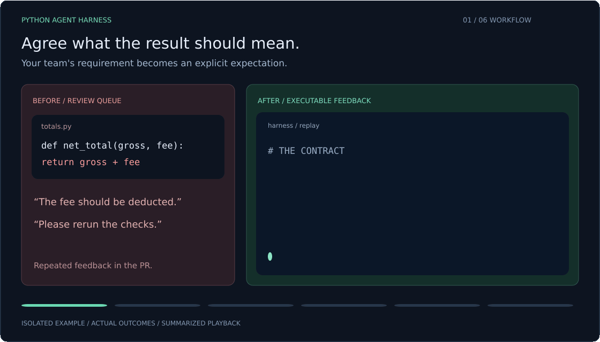
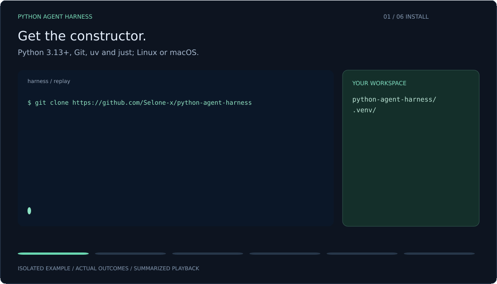

<p align="center"><strong>PYTHON AGENT HARNESS</strong></p>

<h1 align="center">Fast generation.<br>Slow code review?</h1>

<p align="center">
  Tell your AI agent how your project should work.<br>
  Get a harness tailored to your architecture, tools, test invariants and CI.
</p>

<p align="center">
  <a href="#tailor-the-harness-with-your-ai-agent">Watch your agent tailor it</a> &nbsp;·&nbsp;
  <a href="#quick-start">Get started</a> &nbsp;·&nbsp;
  <a href="CONTRIBUTING.md">Build with us</a>
</p>

---

“Wrong import direction.” “What does this test actually prove?” “Did you rerun CI?”

Those conversations repeat across pull requests. **Describe your standards to your
AI coding agent and have it build a harness for your project.** The agent inspects
the repository, preserves your tool choices, proposes rules and tests, and previews
the configuration before applying the agreed changes.

Use your existing coding agent and Python toolchain. The runtime uses the standard
library; no additional LLM API key or hosted harness service is required.

## Tailor the harness with your AI agent



*Illustrated agent request and proposal; the resulting configuration and CLI
outcomes were verified in an isolated project.
[Static version](assets/readme-customize.svg).*

In this example, the request is **keep our tools and keep calculations independent
of I/O adapters**. The agreed specification forbids `my_project.totals` from
importing `my_project.adapters`. The audit catches that import; removing it passes
the same rule, with the existing tool configuration preserved.

You choose the toolchain, architecture boundaries, test invariants, custom lint
rules, quality thresholds and CI budgets. Your agent turns those decisions into
project files and executable checks. Requirements that need human judgment stay
visible for review; the CLI executes the configuration rather than interpreting
your request or calling an LLM itself.

<details>
<summary><strong>See independent tests catch a code regression</strong></summary>

### From comments to checks



*An isolated example with actual check outcomes, summarized for playback.
[Static version](assets/readme-hero.svg).*

The example's contract is **net total = gross − flat fee**. A literal test expects
`net_total(100, 7) == 93`; an implementation that adds the fee fails. The source is
corrected while the expectation stays the same. The next run checks the new inputs
and produces passing evidence.

The harness runs what your project agrees to check. Semantic requirements and the
quality of test oracles remain explicit review work.

</details>

## Quick start

### Install the constructor. Give your agent the project.



*Verified CLI steps with condensed playback and an illustrated agent prompt.
The initial version test is a scaffold smoke test; add behavior tests for features.
[Static version](assets/readme-install.svg).*

Requires **Python 3.13+, Git, uv and just** on Linux or macOS. Windows execution is
currently unsupported.

Get the constructor:

```sh
git clone https://github.com/Selone-x/python-agent-harness
cd python-agent-harness
uv sync --locked --no-dev
```

Open your target project in your existing AI coding agent and give it a request
like this. Replace the checkout path and example requirements with your own:

```text
Read /path/to/python-agent-harness/skills/build-python-harness/SKILL.md.
Build a harness for this project.

Inspect the repository and keep our package manager, formatter and type checker.
Keep calculations independent of I/O adapters.
Net total is gross minus the flat fee; derive tests from independent examples.

Propose architecture boundaries, test invariants, custom rules, quality thresholds
and CI checks. Ask me about decisions the code cannot establish.
Preview changes before applying the agreed plan in a feature branch.
Run the real checks and report what passed and what remains unverified.
```

The agent can create a new project or adopt an existing one. For adoption, it uses
`inspect` and `init` without `--scaffold`, and configures your real commands. You can
also install the skill in your agent's skill directory; see
[skill installation](docs/usage.md#install-the-skills).

<details>
<summary><strong>Run the CLI steps yourself for a new project</strong></summary>

From the constructor checkout, create a project in an empty destination:

```sh
uv run --locked --no-dev harness --root ../my-project init \
  --name my-project --package my_project --kind library \
  --provider github --scaffold
```

Open `../my-project/.harness/project.toml`. Agree the purpose, source and test roots,
architecture boundaries and acceptance criteria with your agent. Validate the
specification and review the preview before applying:

```sh
uv run --locked --no-dev harness --root ../my-project validate
uv run --locked --no-dev harness --root ../my-project render
uv run --locked --no-dev harness --root ../my-project render --apply
```

Run the workflow in your new project:

```sh
cd ../my-project
git init -b feat/bootstrap
just setup
just check
```

Commit the generated `uv.lock` in your feature branch. CI uses that lock. Each
project carries its own `.harness/runner.pyz`, so it can run checks independently
of this checkout. Choose `service`, `cli` or `research` for other project kinds;
use `--provider gitlab`, or both providers, for the corresponding CI.

</details>

**Already have a project?** Start with `inspect`, then `init` without `--scaffold`.
Keep the existing formatter, type checker and package manager; agree their real
commands before rendering. Follow the [adoption guide](docs/usage.md#adopt-an-existing-project).

## What you get

One specification connects **requirements → checks → evidence → acceptance**.
Local `just check` and CI use the same configured groups. Pre-commit runs the static
group; optional deep workloads run explicitly with `just deep`.

<details>
<summary><strong>Explore the checks and optional profiles</strong></summary>

New projects start with these defaults. Adoption preserves the existing project's
agreed tools and thresholds.

| Concern | Tools and acceptance |
| --- | --- |
| Style, types and unused code | Ruff, ty and Vulture scan source and tests |
| Complexity | Ruff C901 ≤10 and Complexipy cognitive complexity ≤15 |
| Project rules | ast-grep fixtures, diagnostic snapshots and source scans; Fixit is available for opt-in Python CST rules |
| Behavior | pytest, complete source coverage inventory, 97% lines and 100% branches; bounded Hypothesis profiles |
| Architecture | Declared import boundaries, including transitive local imports |
| Packaging | Build and wheel import checks for libraries |
| API contracts | Optional Schemathesis profile for an agreed schema and isolated service |
| Assertion sensitivity | Optional bounded mutmut campaign and strict acceptance adapter |

Commands run sequentially with time/output limits. pytest temporary files stay in
the project. Reports bind the source, tests, policy and declared inputs; missing,
failed, skipped or stale required evidence fails the gate. Coverage alone does not
establish assertion quality. Configure hosting protection to require the gate;
generated CI alone does not configure the server.

</details>

## Use your existing agent

Five self-contained skills guide project setup, requirements review, custom rules,
property tests and mutation analysis. Copy the selected folders with their references
and notices into your agent's skill directory; see [installation](docs/usage.md#install-the-skills).

<details>
<summary><strong>Choose a skill</strong></summary>

- [build-python-harness](skills/build-python-harness/SKILL.md) — create, adopt, audit or update the harness.
- [spec-to-code-compliance](skills/spec-to-code-compliance/SKILL.md) — trace requirements to implementation and evidence.
- [semgrep-rule-creator](skills/semgrep-rule-creator/SKILL.md) — build tested rules with the chosen engine, including ast-grep.
- [property-based-testing](skills/property-based-testing/SKILL.md) — design useful generators and independent oracles.
- [mutation-testing](skills/mutation-testing/SKILL.md) — run bounded mutmut campaigns and analyze outcomes.

</details>

## Bring your workflow. Help improve it.

Try adoption on an existing project, contribute a rule with matching/nonmatching
examples, or show where a skill made the wrong decision. Concrete reproductions
and small, verifiable improvements are useful starting points.

[Contribute](CONTRIBUTING.md) · [Usage](docs/usage.md) ·
[Specification](docs/specification.md) ·
[Tool workflows](skills/build-python-harness/references/tool-workflows.md) ·
[Branch protection](skills/build-python-harness/references/protection.md)

## Status and license

**Early preview.** See [scoped skill evaluations](docs/skill-evaluation.md) for
observed behavior and limits. Runtime checks cannot establish every business
invariant or sandbox arbitrary project code.

The **license for the original code and contribution licensing are still pending**.
The four Trail of Bits skill adaptations retain their own **CC BY-SA 4.0** licenses
and attribution notices in their directories.
